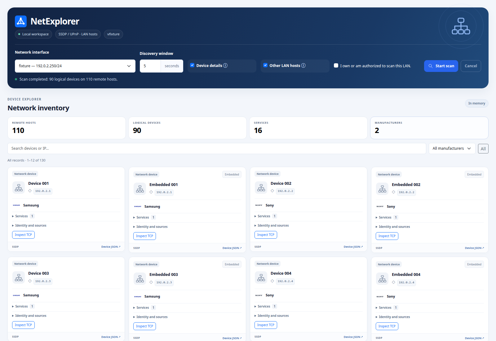

# NetExplorer

A Go application for discovering and inventorying devices and services on your own or an authorized LAN.

## Current status

Phases 1 through 5 provide the CLI, IPv4 interface selection, diagnostics, native SSDP discovery, safe UPnP enrichment, an in-memory logical-device registry, and a browser interface with live SSE events. Optional LAN host discovery and manual Nmap TCP service enrichment are available.

## Requirements and usage

Linux is the initially validated platform. Development requires Go 1.27 or later and Make. On this machine, Go 1.27.1 is installed in `/usr/local/go`; `go` and `gofmt` are available through links in `/usr/local/bin`. For other machines, use the [official Go downloads](https://go.dev/dl/).

```sh
make build
./bin/netexplorer version
make doctor
make setup # Linux: provisions the locked service account; detects the default LAN interface
make run
make run ARGS='--interface eth0 --listen 127.0.0.1:8080'
make check
./bin/netexplorer scan --interface eth0 --timeout 5s
./bin/netexplorer scan --interface eth0 --timeout 5s --enrich
./bin/netexplorer scan --interface eth0 --timeout 5s --enrich --all-hosts
```

To install, copy `bin/netexplorer` to an executable directory of your choice. The binary does not require Go, RTK, or Nmap.

Available commands: `serve`, `scan`, `doctor`, `version`, and `help`. For serve and doctor, `--interface` and `--listen` override `NETEXPLORER_INTERFACE` and `NETEXPLORER_LISTEN`. Scan accepts `--interface`, `--timeout`, `--enrich`, and `--all-hosts` and reads `NETEXPLORER_INTERFACE`.

Open http://localhost:8080/, select an interface, confirm authorization for the LAN, and start a scan. UPnP descriptions are optional. Scan controls sit in the header, with three inventory columns on wide screens and fewer on smaller displays. The page shows live progress, compact device cards, manufacturer logos, and collapsible services/evidence. Click a total to show one record per remote IP, identified UPnP identities, records with UPnP or open TCP services, or known manufacturers. Search names/IPs/models/brands, select a manufacturer, and page through 12, 24, or 48 records. Filters survive live inventory refreshes. Missing model/manufacturer information uses accessible icons with tooltips. The default host view groups logical identities by IP; expand Device identities or switch to Logical devices to inspect each record. Device/host JSON opens in an accessible modal with a sticky header, syntax colors, and line numbers; LAN data is rendered using text nodes. TCP inspection shows an animated status panel. Services expand without nested scrolling; warnings and cancellation remain available. Twenty manufacturer logos are bundled locally; unknown brands use a neutral icon. Embedded devices can inherit the displayed manufacturer from their same-IP parent without changing inventory evidence. Bootstrap 5.3.8, HTMX 2.0.8, and application JavaScript are embedded locally; no CDN or Node build is required.

## Interface preview

The example below uses synthetic devices and documentation-only IP addresses, not a captured LAN inventory.



## API

- `GET /api/health`: application status and version.
- `GET /api/interfaces`: interfaces, IPv4 addresses, flags, and gateway when available.
- `GET /api/tools`: optional tool availability without executing tools.
- `GET /api/hosts` and `GET /api/hosts/:id`: IP-level records, discovery evidence, and TCP results.
- `POST /api/hosts/:id/nmap` or `POST /api/devices/:id/nmap`: explicitly inspect one known remote IP; body `{"authorized":true}`.
- `GET /api/nmap/:id` and `POST /api/nmap/:id/cancel`: manual job state and cancellation.
- `GET /api/checks/catalog`: reviewed manual NSE actions.
- `POST /api/hosts/:id/checks`: run one compatible observed service check; body `{"authorized":true,"check_id":"smb-vuln-ms17-010","port":445}`.
- `GET /api/checks/:id`, `POST /api/checks/:id/cancel` and `GET /api/hosts/:id/checks`: retained check state, cancellation and results.
- `GET /api/devices` and `GET /api/devices/:id`: latest scan inventory and individual device evidence.
- `POST /api/scans`: start an authorized scan; returns HTTP 202 with its ID and events URL.
- `GET /api/scans/latest` and `GET /api/scans/:id`: scan status, partial inventory, and warnings.
- `GET /api/scans/:id/events`: SSE with numeric event IDs and Last-Event-ID replay.
- `POST /api/scans/:id/cancel`: cancel while retaining collected evidence.

POST requests require an `X-CSRF-Token` header containing the token from the home page meta tag and pass same-origin checks. A scan body is `{"interface":"eth0","seconds":5,"enrich":true,"all_hosts":false,"authorized":true}`. Seconds range from 1 to 60; omitted seconds default to 5. Missing interface selects the configured default. Unknown fields and multiple JSON values are rejected. One discovery scan, TCP inspection, SMB listing or manual NSE check runs at a time (HTTP 409 while busy). The last eight sessions and 512 events per session are retained; expired sessions return HTTP 404. Inventory belongs to the latest started scan and resets when a new one starts. Restarting the server clears all sessions.

SSE names include check-updated and scan-started, host-found, device-found, device-updated, service-found, host-discovery-started, host-updated, scan-complete, and scan-error. Event payloads are small notifications; fetch inventory separately. A reset event means replay history was exceeded and the client should reload scan state. Streams send heartbeats, allow up to 16 concurrent connections, have a two-minute lifetime, and use five-second write deadlines. The browser reconnects and recovers a running scan on reload.

The default listener is `127.0.0.1:8080`. Authentication is not implemented; keep access local. Automatic interface selection prefers the default IPv4 route, then an active multicast interface, then the first active IPv4 interface. Use `--interface` with VPNs or multiple networks. Loopback and inactive interfaces are rejected.

## Architecture and tools

`cmd` coordinates the CLI, configuration, discovery, and server. Only `internal/web` imports Gin. Direct dependencies are Gin and `golang.org/x/net/ipv4`, which controls the multicast interface and TTL. Transitive dependencies are recorded in go.mod/go.sum. Diagnostics locate optional tools through PATH without executing them. Discovery starts only through the explicit `scan` command or an authorized browser/API POST. Starting `serve`, opening the page, and running `doctor` do not initiate scans.

Nmap, smbclient, and showmount are optional. gssdp-discover and gupnp-av-cp are diagnostic references. RTK is development tooling only.

## SSDP discovery

Run `./bin/netexplorer scan --interface NAME --timeout 5s` only on your own or an authorized LAN. The command sends one M-SEARCH request with MX 3 to 239.255.255.250:1900 and TTL 1. The default discovery window is 5 seconds; accepted values range from 1 second to 1 minute. Windows shorter than MX may miss late responses.

JSON includes the source IP, LOCATION, USN, ST, SERVER, CACHE-CONTROL, EXT presence, and observation time. Distinct announcements remain separate; this is not yet a merged equipment inventory. Responses outside the first selected IPv4 address's subnet are ignored. Limits are 16 KiB per datagram and 4096 distinct announcements. Advertised URLs are untrusted evidence and are only fetched when `--enrich` is explicitly enabled. All IPv4 addresses belonging to the local machine are excluded before inventory updates or enrichment, including aliases on other interfaces. No responses produces `[]`, which does not necessarily indicate a failure. SSDP finds UPnP advertisers rather than every LAN host. Enable the optional Nmap host-discovery mode below to include other responding hosts. The browser counts logical devices and unique remote IPs separately.

## UPnP enrichment and inventory

Add `--enrich` to scan for a report with `devices`, IP-level `hosts`, and `warnings`. Plain scan still returns the original SSDP announcement array. Enrichment runs after discovery with four workers, up to 256 distinct IP/LOCATION requests, a 30-second total window, and five seconds per HTTP request. A failed description preserves the SSDP record and adds a warning.

Only the announcing IPv4 peer in the selected subnet may be contacted. Local host addresses, loopback, link-local, multicast, and network/broadcast targets are rejected. DNS results must all match the peer; sockets connect to the pinned IP, bypass proxies, and bind to the selected local address. Redirects are limited to three and remain under the same peer policy. HTTPS uses normal certificate validation; untrusted certificates are not bypassed.

XML is limited to 1 MiB, depth 32, 8192 elements, 64 logical devices, and 256 services per document. DTDs, unknown entities, duplicate singleton fields, and invalid device identities are rejected. During enrichment, repeated UDNs retain the first device and its hierarchy while later duplicate branches are omitted with warnings; the other valid profiles remain available. All branches count toward safety limits before pruning. The strict UPnP Parse API continues rejecting duplicates. Service and presentation URLs remain untrusted metadata; no control or subscription action is performed.

The registry correlates UUID claims, retains embedded devices and parent IDs, and records field provenance and conflicting values. Friendly names and IP addresses alone do not identify equipment. Each record includes attributes, services, USNs, locations, timestamps, and evidence. Inventory is per scan and held in memory. Browser/API scans retain eight sessions and expose the latest inventory; persistence remains future work.

## Other LAN hosts and manual TCP inspection

Use **Other LAN hosts** (selected by default when Nmap is available) before starting an authorized browser scan, or use `scan --all-hosts`. This optional mode requires `nmap` on PATH and adds up to 60 seconds after SSDP/UPnP. It combines `-sn -n -PS22,80,443,445` Nmap host discovery with unprivileged ICMP echo, without a full port scan, on the selected interface's first IPv4 subnet. Subnets larger than /22 are rejected; local addresses, aliases, network, and broadcast addresses are excluded. ICMP uses at most 64 concurrent sockets and two requests per target, binding to the selected IPv4 address. Replies must match the target, sequence, and random payload. Kernel ping-socket permissions may disable this supplement. No privilege elevation is requested. Hosts that are asleep, isolated, or filtered may remain undiscovered; this option cannot guarantee every host will respond.

Each additional host has a visual card even without SSDP or UPnP. Host records group evidence by IP within the current scan; separate logical UPnP devices keep their UUID identities. A MAC vendor reported by Nmap is evidence, not proof of the equipment manufacturer. Missing Nmap disables the additional-host option and manual buttons while SSDP/UPnP remains available.

Use **Inspect TCP** on a card to inspect only that known IP, after confirming LAN authorization. **Common + notable** covers TCP 1–1024 plus selected high-port services and reviewed historical associations; **All 65,535 TCP ports** covers TCP 1–65535. Fixed arguments use `-sT -Pn -sV --version-light -T4 -p <fixed-range> -n`, with two- and five-minute host deadlines respectively. No OS detection, traceroute, custom NSE, vulnerability probes, passwords or privilege elevation are requested. Nmap's default version-detection exclusion for printer port 9100 remains in effect. Requested coverage is stored only on successful completion; timeouts/cancellation preserve prior evidence. The last eight manual jobs are retained, and reload resumes polling.

Cards show up to four TCP observations with state icons and accessible tooltips. **All TCP services** opens a searchable modal with state/reference filters and 50 rows per page. HTTP/HTTPS links use the observed literal IP, port and detected TLS wrapping. Other endpoints can be copied; an open RDP service offers a `.rdp` download. **Shared folders** explicitly requests anonymous announced disk-share metadata via optional `smbclient`; it does not open shares, read files, supply credentials or guess names. Hidden/admin shares are excluded. This action also occupies the shared network slot and has a ten-second process limit.

The reviewed offline catalog flags historical TCP associations (NetBus, SubSeven, Back Orifice 2000 and the compromised vsftpd distribution) as informational references, never proof of infection. It provides potential exact-version CVE matches for vsftpd 2.3.4 and Apache httpd 2.4.49/2.4.50, with applicability caveats and official sources. The catalog is deliberately limited: an absent match does not mean a host is secure. Detected product/version pairs also offer a manual NVD search link; no automatic external requests or vulnerability tests run. See [TCP services and reference policy](docs/TCP-SERVICES.md).

Manual NSE actions are available in the services popup: **RDP details**, **SMB signing**, **SMB time** and **Check MS17-010**. Opening an action shows its interaction note; **Run check** is a separate authorized action. The application uses one fixed installed script and observed compatible port, with bounded deadlines and cancellation. MS17-010 uses anonymous IPC$ metadata with Guest fallback disabled, without password attempts or exploits. A recognized patched-system response is required for a negative assessment; connection errors are inconclusive. CVEs come from structured script evidence. Retained results include timestamps, Nmap version and escaped evidence, independently of offline potential references. MS12-020 is deferred. See [NSE integration and API](docs/NSE-INTEGRATION.md).

## Security checks

```sh
make check
make security
make security-report
```

Analysis tools are pinned in the separate devtools module and built locally without global installation. See [SAST and security gates](docs/SAST.md) for CI, reports, policy, and limitations.

## Roadmap and contribution

0.1: SSDP, UPnP, registry, frontend/SSE, and manual Nmap. 0.2: mDNS, ARP, SMB/NFS. 0.3: DLNA. 0.4: WebDAV and fingerprinting. 0.5: persistence and history.

See [Web assets](docs/WEB-ASSETS.md), [Architecture](docs/ARCHITECTURE.md), [Security](docs/SECURITY.md), [Roadmap](docs/ROADMAP.md), and [Contributing](CONTRIBUTING.md). Documentation and code comments use English and Go doc comments. The original specification in `ini.txt` is preserved in its original language.

Windows hosts support local evidence import through **Windows assessment** on
inventory cards. Download the read-only collector, run it locally on the endpoint,
and import its JSON. See [Windows assessment](docs/WINDOWS-ASSESSMENT.md) for the
supported evidence, initial CVE rules and explicit coverage limits.

MAC identification, private address indicators, registry updates and mDNS hints are documented in [MAC registry maintenance](docs/MAC-VENDORS.md).

Initial Linux setup is idempotent: `make setup INTERFACE=eth0` selects an explicit interface. It provisions the system account with a locked password and nologin shell, removes supplementary groups, creates private data directories, installs root-owned binaries and validates the ARP-only sudoers rule. Existing conflicting account/policy configuration is rejected for administrator review. No developer credentials or login-enabled shell are installed. Missing runtime packages are installed from the distribution repositories. `make run` assumes setup has completed; `make run-dev` runs under the developer account.

`make setup` also checks and installs missing Nmap, arp-scan, smbclient and OpenSSH client tools, plus Linux account/network provisioning utilities. Debian/Ubuntu, Fedora/RHEL, Arch and openSUSE families have fixed package mappings. Already available tools are preserved. Preview without changes with `make setup-tools-check`. No repositories are added automatically; missing repository packages produce an actionable error. Go and Make are development prerequisites and remain installed at system level, outside the project. PowerShell on Linux, showmount and GSSDP/GUPnP reference tools are reported as optional: the current Windows collector invokes PowerShell on the Windows endpoint through SSH, not local pwsh. See [Microsoft's Linux installation documentation](https://learn.microsoft.com/en-us/powershell/scripting/install/linux-overview) for optional local PowerShell setup.

Use **Save results** and **Load results** to keep and review inventory across sessions. Imports open a read-only view without resuming scans. See [saved inventory analysis](docs/SNAPSHOTS.md).
